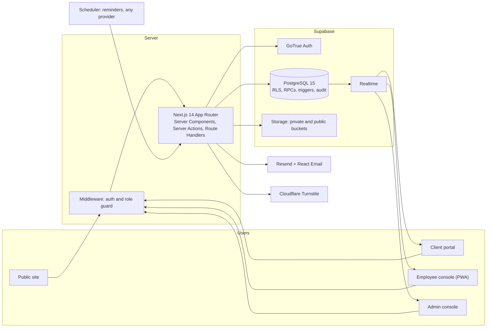
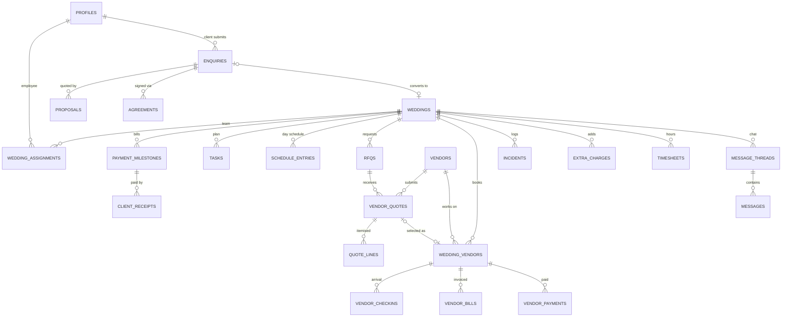

<!-- Phase 5 agent: this README describes the TARGET state. Before release, remove anything that was not built and verify every command and demo login from a clean clone. -->

# Vivona

**One platform for the whole wedding, from the first enquiry to the final vendor payment.**

Vivona is an operations platform for a luxury wedding planning agency planning multi-day destination weddings. It replaces WhatsApp groups, PDF quotes, paper checklists and payment notebooks with a single, role-based web app backed by a real database.

- **Product:** Vivona Luxury Wedding Management Platform
- **Stack:** Next.js 14 · TypeScript (strict) · Supabase (Postgres, Auth, RLS, Realtime, Storage) · Tailwind · shadcn/ui

---

## Why Vivona

| Before Vivona | With Vivona |
|---|---|
| Enquiries arrive by call, Instagram and WhatsApp and get forgotten | Every enquiry is captured in one pipeline with stale-follow-up alerts |
| Vendor quotes are PDFs in WhatsApp groups, compared by hand | Quotes are structured and compared side by side, line by line, with price per plate |
| Checklists live in paper diaries and are rewritten for each wedding | A 30+ task plan is generated per wedding, each task with an owner and a stage |
| Payments are tracked in notebooks, advances are missed | Staged milestones, idempotent payment recording, overdue reminders |
| Profit is known long after the wedding | Profit per wedding and across the season, always computed from real records |

---

## Roles and access

Vivona has exactly three roles. Access is enforced in three layers: route middleware, server-side checks in every action, and Postgres Row Level Security on every table.

| Capability | Admin | Employee | Client |
|---|---|---|---|
| Public site, packages, social proof | ✓ | ✓ | ✓ |
| Submit enquiry or custom quote request | on behalf of client | – | ✓ own |
| Pipeline, proposals, agreements | ✓ | – | view, accept, sign own |
| Vendors, RFQs, quote comparison | ✓ | read contacts, assigned weddings | shortlist visible only after signing |
| Create wedding, assign employees | ✓ | – | – |
| Message the client | ✓ | only on assigned weddings | own wedding thread |
| Tasks, live schedule, check-ins, incidents | ✓ all | assigned weddings | read-only summary |
| Vendor bills, payments, margins, analytics | ✓ | – | – |
| Extra charges | approve | request | view approved |
| Users, roles, site content | ✓ | – | – |

Public sign-up creates clients only. Admin and employee accounts are created by an admin invite.

---

## How the six business scenes are covered

| Scene | What Vivona does |
|---|---|
| 1. First consultation | Enquiry captured in the CRM with date, guest count, theme and budget. Service agreement is sent and signed on the phone; the signed PDF stays on the client record. |
| 2. Three caterers, one decision | Three quotes are compared line by line with price per plate. Selecting one closes the others (history kept) and links the vendor to the wedding. |
| 3. Instant wedding plan | Confirming the booking deposit generates a 30+ task plan with owners and stages, plus booking / advance / final payment milestones. |
| 4. Big-day schedule | Live minute-by-minute timeline, vendor check-in board with automatic late flags, incident log with owners. Real-time across devices and readable offline. |
| 5. Paying vendors and extra costs | Vendor ledger (agreed, advance, bill, balance), approved extras such as 60 additional guests billed to the client, duplicate-payment protection. |
| 6. Founder's season review | Profit per wedding, season table, vendor scorecard, 30-day receivables and payables, PDF export. |

---

## Key engineering decisions

- **The wedding is the central record.** Tasks, vendors, quotes, schedules, payments and incidents all link to a wedding.
- **Money is integer paise.** No floating point; amounts are formatted in INR with lakh and crore grouping.
- **Originals are immutable.** Quotes and agreements are never overwritten by invoices. Estimated, agreed, invoiced, paid and outstanding amounts are separate values.
- **Payments are transactional and idempotent.** All payment writes go through a single Postgres RPC with a unique idempotency key and reference; overpayment is rejected.
- **Profit is revenue minus attributable cost,** not cash in minus cash out.
- **Security lives in the database.** RLS on every table, helper functions for admin, assignment and client checks, and an agreement gate that hides vendor lists and floor plans until the contract is signed.
- **Audit trail.** Trigger-written audit events for financial rows, status changes and assignments.
- **Dynamic data only.** No static JSON; seed data is stored as real rows and dashboards are SQL-backed.

---

## Architecture



## Data model (core entities)



---

## Tech stack

| Area | Technology |
|---|---|
| Framework | Next.js 14 (App Router, Server Components, Server Actions) |
| Language | Strict TypeScript, zero build errors |
| UI | Tailwind CSS, shadcn/ui, Framer Motion |
| Forms and validation | React Hook Form, Zod (shared client and server schemas) |
| Database and auth | Supabase PostgreSQL 15, GoTrue Auth, Row Level Security |
| Real time | Supabase Realtime |
| Storage | Supabase private and public buckets |
| Email | Resend, React Email |
| Spam protection | Cloudflare Turnstile |
| Charts and PDFs | Recharts, @react-pdf/renderer |
| E-signature | signature_pad |
| Offline | Service worker (read-only cache, queued writes) |
| Testing | Vitest (unit and permission logic), Playwright (E2E at mobile and desktop) |
| Hosting | Decided later; the app is host-agnostic (Supabase provides database, auth and storage) |

---

## Getting started (local, works offline)

**Prerequisites:** Node.js 20+, pnpm, Docker, and the [Supabase CLI](https://supabase.com/docs/guides/cli).

```bash
# 1. Clone and install
git clone <repo-url> vivona
cd vivona
pnpm install

# 2. Configure environment
cp .env.example .env.local        # then fill in the values below

# 3. Start the local Supabase stack (Postgres, Auth, Storage, Realtime)
pnpm db:start

# 4. Apply migrations and reference data, then create demo users and rows
pnpm db:reset
pnpm db:seed

# 5. (Optional) Generate a 25-wedding demo season for the analytics dashboard
pnpm db:seed-season

# 6. Run the app
pnpm dev                          # http://localhost:3000
```

Use the local URL and keys printed by `supabase start` for the Supabase variables. Use Cloudflare's Turnstile test keys in development.

### Environment variables

| Variable | Purpose |
|---|---|
| `NEXT_PUBLIC_SITE_URL` | Public base URL of the app |
| `NEXT_PUBLIC_APP_NAME` | Product name (`Vivona`) |
| `NEXT_PUBLIC_SUPABASE_URL` | Supabase project URL |
| `NEXT_PUBLIC_SUPABASE_ANON_KEY` | Supabase anon key (safe for the browser) |
| `SUPABASE_SERVICE_ROLE_KEY` | Service role key, **server only**, never exposed to the browser |
| `RESEND_API_KEY` | Email sending |
| `NEXT_PUBLIC_TURNSTILE_SITE_KEY` | Turnstile widget key |
| `TURNSTILE_SECRET_KEY` | Turnstile server verification |
| `CRON_SECRET` | Protects the scheduled reminder endpoint |
| `DEMO_PASSWORD` | Password for demo accounts (local and demo seed only) |

Never commit `.env.local` or any secret.

### Scripts

| Script | What it does |
|---|---|
| `pnpm dev` | Start the development server |
| `pnpm build` / `pnpm start` | Production build and server |
| `pnpm typecheck` | TypeScript check |
| `pnpm lint` | ESLint |
| `pnpm test` | Vitest unit and permission tests |
| `pnpm test:e2e` | Playwright end-to-end tests (390 px and 1440 px) |
| `pnpm db:start` | Start local Supabase |
| `pnpm db:reset` | Re-apply migrations and `seed.sql` |
| `pnpm db:seed` | Create demo auth users and rows |
| `pnpm db:seed-season` | Generate a 25-wedding season |
| `pnpm db:types` | Regenerate TypeScript types from the database |

### Demo accounts

All demo accounts use the password set in `DEMO_PASSWORD`.

| Role | Email |
|---|---|
| Admin | `admin@vivona.demo` |
| Employee | `planner1@vivona.demo`, `planner2@vivona.demo`, `planner3@vivona.demo` |
| Client | `couple1@vivona.demo`, `couple2@vivona.demo`, `couple3@vivona.demo` |

These exist for local and demo use only. The production seed generates random passwords.

---

## Project structure

```
src/
  app/
    (marketing)/   public site, packages, social proof, booking wizard
    (auth)/        sign in, sign up, invite acceptance
    (client)/      client portal
    (employee)/    employee console and live-day screens
    (admin)/       admin console, finance, analytics
    api/           route handlers (cron, webhooks, exports)
  components/
    ui/            shadcn primitives
    features/      module components (crm, vendors, planning, live, finance)
  lib/
    brand.ts       product name
    supabase/      server, browser and middleware clients
    validation/    shared Zod schemas
    finance/       money helpers and calculators
    permissions/   role and assignment checks
    email/         React Email templates
supabase/
  migrations/      schema, RLS policies, RPCs, triggers
  seed.sql         reference data
scripts/           seed.ts, seed-season.ts
tests/             unit/ and e2e/
docs/              DECISIONS.md and design notes
```

---

## Testing

- **Vitest:** finance calculators, price-per-plate comparison, permission matrix, workflow state transitions, payment idempotency, and RLS access checks (an employee cannot read an unassigned wedding; a client cannot read another client's data; a user cannot change their own role).
- **Playwright:** three role journeys at 390 px and 1440 px — client books and signs; admin runs pipeline, confirmation, assignment and caterer comparison; employee chats and runs the live day; finance settlement.

```bash
pnpm typecheck && pnpm lint && pnpm test && pnpm build
```

---

## Deployment

Hosting is planned separately and is not configured in this repository. The app is host-agnostic: no platform-specific APIs, and all configuration comes from environment variables. Whatever host is chosen needs to provide:

1. A Supabase project with migrations applied (`supabase link`, then `supabase db push`).
2. Every variable from the environment table above.
3. A scheduler that calls the protected reminder endpoint (`/api/cron/reminders`) with `CRON_SECRET`, or use the admin "Run reminders now" button.
4. A smoke test of sign-in for each role after the first release.

---

## Security

- Row Level Security on every table; views use `security_invoker` or are wrapped in admin-checked RPCs.
- The service role key is used only in server code.
- Private storage buckets with short-lived signed URLs; uploads validated by type, size and content.
- Cloudflare Turnstile and throttling on public forms.
- Security headers (CSP, HSTS, X-Frame-Options, Referrer-Policy).
- Audit events for financial and status changes.

---

## Git workflow

- Branches: `phase-N/<feature>`, merged through pull requests into `main`.
- Commits follow Conventional Commits (`feat:`, `fix:`, `test:`, `docs:`).
- Every teammate commits under their own identity.

| Member | Area |
|---|---|
| Krishna L | Team lead and frontend |
| Manobalaji S | Backend |
| Prithith A | Security and documentation |
| Mohammed Ibrahim M | Database |

---

## Known limitations

- Payments are recorded manually (no payment gateway); online payments are a future step.
- Email delivery uses Resend's test sender until a domain is verified; every email also creates an in-app notification.
- Social proof is admin-curated rather than pulled live from social platforms.

## Notes

Demo names and data are fictional.
