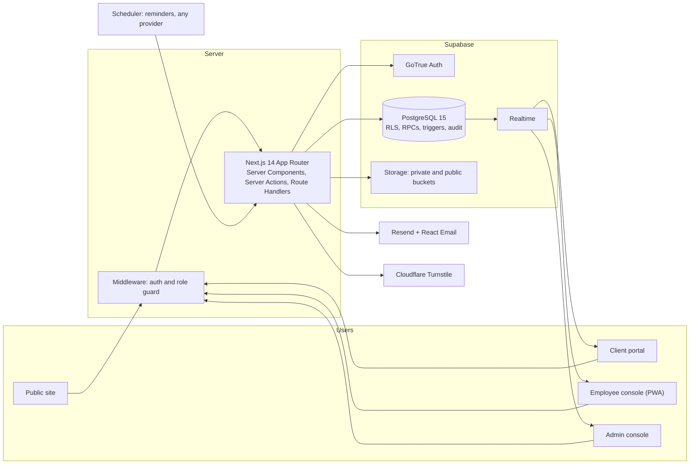
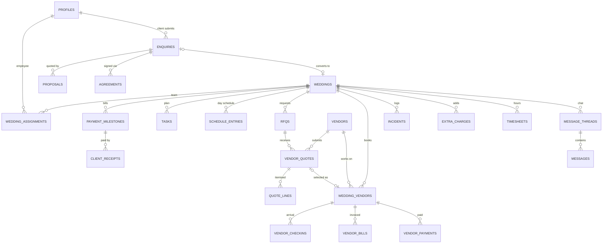

# Vivona — Complete Copy-Paste Pack

Two files, each inside its own code block so you can use the copy button.

| # | Save as | Where it goes | Use |
|---|---|---|---|
| 1 | `AGENTS.md` | Repo root (or Antigravity workspace rules) | Master build prompt: Part 0 context + 5 phases + appendices |
| 2 | `README.md` | Repo root | Project README (target state, reconciled in Phase 5) |

Workflow: save file 1 as `AGENTS.md`, then paste **one PHASE block at a time** into a new Antigravity Planning-mode chat.

---

## FILE 1 of 2 — `AGENTS.md`

````markdown
# VIVONA — Wedding Planning Platform · Master Build Prompt
**Product: Vivona · 18-hour build · Google Antigravity · Next.js 14 + Supabase · Deployment decided later**

## How to use this file
1. Save **PART 0** as `AGENTS.md` in the repo root (or your Antigravity workspace rules) so every agent inherits it. Put the provided `README.md` in the repo root too.
2. Paste **one PHASE block at a time** into a fresh Planning-mode conversation. Approve the Implementation Plan before any code is written.
3. Do not start the next phase until the **Phase Gate** passes. If time runs short, drop items from the **Cut-line** in the order listed.

| Phase | Clock | Focus |
|---|---|---|
| 1 | 0:00 – 2:30 | Foundation: full schema, RBAC/RLS, auth, seed, **production build runs locally** |
| 2 | 2:30 – 6:00 | Client experience: public site, social proof, package/custom booking, e-sign |
| 3 | 6:00 – 9:30 | Admin command center: CRM → proposal → vendor comparison → wedding + auto plan → assignment |
| 4 | 9:30 – 13:30 | Employee workspace: client chat, tasks, live big-day operations (real-time, offline-ready) |
| 5 | 13:30 – 18:00 | Finance engine, founder analytics, hardening, tests, **release-ready build** |

Hours 18–24 are reserved for rehearsal, bug buffer and the pitch. **No new features after hour 18.**

---

# PART 0 — PERSISTENT CONTEXT (applies to every phase)

## 0.1 Mission
Build **Vivona**, a **production-grade, responsive, role-based web platform** for a luxury wedding planning agency operating in Jaipur and Udaipur (about 25 three-day weddings a season, 400+ guests, about 18 vendors per wedding, crore-scale budgets). Vivona replaces WhatsApp groups and paper diaries across the full lifecycle: **enquiry → agreement → vendor quotes → instant plan → live wedding day → settlement → profit review.**

North star. At any moment the system must answer: (1) What is happening with every wedding? (2) Who is responsible for what, and what needs attention? (3) Are we actually making money?

## 0.1b Naming and brand (Vivona)
- **Vivona** is the product name and the only brand name used anywhere in the app. Do not invent or use any other agency name. Build for **one agency**; do **not** build multi-tenancy.
- Use "Vivona" in: browser title template `%s · Vivona`, header/footer wordmark, PWA manifest `name` and `short_name`, favicon, email sender display name and React Email header, `package.json` name (`vivona`), repo name, README, and the agreement PDF header. Agreement parties are written as "Vivona" and "the Client".
- **Wordmark:** typographic "Vivona" in Cormorant Garamond with a small gold knot glyph (inline SVG) as a reusable `<Logo />` component; derive the favicon from it. No raster logo needed.
- Read the name from one file, `src/lib/brand.ts` (`APP_NAME`, from `NEXT_PUBLIC_APP_NAME`). Never hard-code brand strings elsewhere.
- Wedding codes look like `VIV-2026-001`. Demo emails use `@vivona.demo`.

## 0.2 Hackathon judging rules → how we satisfy them
| Organizer requirement | Our answer |
|---|---|
| Real-time / dynamic data, no static JSON | Everything lives in Supabase Postgres. Seed data = real rows. Dashboards come from SQL views/RPCs. Supabase Realtime drives schedule, check-ins and chat. |
| Responsive, clean UI, consistent colors/layout | One design-token system. Mobile-first for event-day screens. Verify at 390 / 768 / 1440 px. |
| Robust input validation | Shared Zod schemas (client and server) + DB constraints (CHECK, FK, UNIQUE, enums) + state-transition guards. |
| Intuitive navigation, proper menu spacing | Role-specific sidebar (desktop) and bottom nav (mobile), breadcrumbs, empty states, consistent 8-pt spacing. |
| Proper Git use (not one person) | Feature branches, Conventional Commits, PRs, each teammate commits under their own identity. |
| Nice-to-have: local DB, offline plan, understand every snippet, no pointless trendy tech | `supabase start` local stack with migrations + seed; PWA read-only cache + queued writes for live day; every non-trivial snippet explained in its PR; only the extra libraries listed in 0.4. |

## 0.3 Roles and access (exactly three roles)
| Capability | **Admin** (founder; also covers finance, vendors, analytics) | **Employee** (planner / on-site coordinator) | **Client** (couple) |
|---|---|---|---|
| Public site, packages, social proof | ✓ | ✓ | ✓ |
| Submit enquiry / custom quote request | ✓ on behalf of client | – | ✓ own |
| View all enquiries and pipeline | ✓ | – | own only |
| Build/send proposals and agreements | ✓ | – | view, accept, sign own |
| Vendors, RFQs, quote comparison, selection | ✓ | read vendor contacts for assigned weddings | sees shortlist **only after agreement signed** |
| Create wedding, **assign employees** | ✓ | – | – |
| Message the client | ✓ | **only on weddings assigned to them** | own wedding thread |
| Tasks, schedule, check-ins, incidents, timesheets | ✓ all | assigned weddings only | read-only summary of own |
| Client payment milestones | ✓ record | read status for assigned | view own |
| Vendor bills/payments, margins, profit | ✓ | ✗ | ✗ |
| Extra charges | approve | request | view approved |
| Analytics, exports, users/roles, site content | ✓ | ✗ | ✗ |

Rules:
- Public sign-up creates **`client` only**. Admin and employee accounts are created only by an admin invite (server action using the service-role key, **server-side only**).
- Role lives in `profiles.role`; never trust role data sent from the browser.
- Enforce at **three layers**: (1) `middleware.ts` route guards, (2) role + assignment checks inside every Server Action and Route Handler, (3) **Postgres RLS on every table**. Hiding a button is not security.
- Until a wedding is assigned, the **admin** handles all client communication. Employee-to-client messaging starts only at assignment (enforced by RLS).

## 0.4 Tech stack (fixed — team already knows it)
Next.js 14 (App Router, Server Components, Server Actions; **do not upgrade**) · strict TypeScript (no implicit `any`, zero build errors) · Tailwind CSS + shadcn/ui + Framer Motion · Supabase (PostgreSQL 15, GoTrue Auth, RLS, Realtime, private/public Storage) · Resend + React Email · Cloudflare Turnstile · Vitest + Playwright · pnpm. **Hosting and deployment are out of scope for now:** keep the app host-agnostic (no platform-specific APIs, all configuration via environment variables) and do not configure any hosting provider.

**Allowed additions (only because each adds real value):** `@supabase/ssr`, `zod`, `react-hook-form` + `@hookform/resolvers`, `recharts` (analytics), `signature_pad` (e-sign), `@react-pdf/renderer` (agreements, invoices, reports), `date-fns`, `@dnd-kit/core` (task board), Serwist or a small hand-written service worker (offline). Nothing else without a one-line justification in `docs/DECISIONS.md`.

## 0.5 Domain rules (non-negotiable)
- The **Wedding** is the central record; everything links to `wedding_id`.
- **Money = integer paise (`bigint`), INR.** Never floats. Format with `Intl.NumberFormat('en-IN')` and show lakh/crore.
- **Originals are immutable.** Quotes, proposals and agreements are never overwritten by invoices. Keep Estimated / Agreed / Invoiced / Paid / Outstanding as separate, visibly distinct values.
- Client receipts and vendor payments are **separate flows**. Every payment write goes through **one Postgres RPC in one transaction**, with a unique `idempotency_key` and unique `(direction, reference)`; overpayment is rejected; double-click and retry are safe.
- **Selecting a quote** is a transactional RPC: mark winner → close the other RFQs as `closed_not_selected` (history preserved and viewable) → create the `wedding_vendors` link. Selecting twice is rejected.
- **Profit** = recognized revenue (accepted proposal + approved extras) − attributable cost (agreed/invoiced vendor amounts + approved extras + labour hours × rate). It is **not** cash-in minus cash-out.
- **Audit:** trigger-written `audit_events` (actor, action, record, old/new, timestamp) for financial rows, status changes and assignments.
- **Agreement gate:** vendor lists and floor plans are hidden from the client until the agreement is signed (enforced in RLS, not just UI).
- **Social proof ("citations"):** an admin-curated `social_proof` table (platform, handle, post URL, thumbnail, caption/testimonial). No scraping, no dependency on unapproved Instagram APIs.
- Views that expose financial data use `security_invoker = true` or are wrapped in RPCs that check `is_admin()`.
- Every email also writes an in-app `notifications` row, so the demo never depends on email deliverability (use Resend's test sender and Turnstile test keys in dev).

## 0.6 Engineering standards
- `pnpm typecheck && pnpm lint && pnpm test && pnpm build` must pass before every commit.
- Server Actions return `{ ok: true, data } | { ok: false, error, fieldErrors? }` and Zod-validate every input. Rate-limit public forms (Turnstile + simple throttle).
- Every list has loading skeleton, empty state, error state and pagination. Every form has inline errors, a submitting state and a toast.
- Accessibility: labelled inputs, visible focus, AA contrast, honour `prefers-reduced-motion`.
- **Design tokens:** ivory `#FBF7F0`, maroon `#6B1D2A`, antique gold `#C8A24A`, charcoal `#1F1A17`, sage `#6F8F72` (success), terracotta `#B5533C` (danger). Fonts: Cormorant Garamond (display) + Inter (UI). 8-pt spacing, 12 px radius. shadcn themed to these tokens. Framer Motion only for meaningful motion (hero reveal, page transitions, list stagger, ≤300 ms).
- Structure:
```
src/app/(marketing) (auth) (client) (employee) (admin) api/
src/components/ui | features/<module>
src/lib/ supabase/ validation/ finance/ permissions/ email/
supabase/migrations | seed.sql      scripts/   tests/unit | e2e   docs/
```
- Git: branches `phase-N/<feature>`, Conventional Commits, one PR per feature (summary + "what I verified"), each teammate commits from their own `git config user.name/email`, never commit secrets, keep `.env.example` current.
- Team (for branch ownership and PR review): **Krishna L** — team lead and frontend (pages, components, UX); **Manobalaji S** — backend (server actions, API/route handlers, RPC wiring); **Prithith A** — security and documentation (RLS review, validation audit, security headers, README, `docs/DECISIONS.md`); **Mohammed Ibrahim M** — database (migrations, RLS policies, RPCs, triggers, seeds). Keep each agent's changes within one owner's layer where possible and name that owner as PR reviewer.

## 0.7 Agent operating protocol (every phase)
1. **Plan first.** Produce an Implementation Plan and Task List (files, assumptions, risks). **Stop and wait for my approval.**
2. Build in thin **vertical slices**: migration → validation schema → server action/RPC → UI → test.
3. Run 2–3 parallel agents only on **disjoint folders**; never two agents on the same file or migration.
4. Verify every new screen with the browser agent at **390 px and 1440 px**; attach screenshots to the Walkthrough.
5. Ambiguity: pick the simplest option consistent with this document, log it in `docs/DECISIONS.md`, and keep going. Ask only if blocked.
6. Finish with: Phase Gate results (pass/fail), what was cut, known issues, and a 5-line plain-English explanation of the key engineering decisions so I can defend them to judges.
7. No scope creep beyond the current phase.

---

# PHASE 1 — FOUNDATION (0:00 – 2:30)
**Objective:** a running, authenticated, role-gated shell sitting on the *complete* database, so later phases only add logic and UI.

**Build**
1. **Scaffold** the `vivona` project on Next.js 14 (App Router, TS strict, Tailwind, shadcn/ui, Framer Motion, pnpm). Apply the design tokens, create `src/lib/brand.ts` and the `<Logo />` wordmark. Create layout shells for `(marketing)`, `(client)`, `(employee)`, `(admin)` with role-appropriate navigation.
2. **Full schema** via Supabase migrations (enums, FKs, CHECKs, indexes, `updated_at` triggers):

| Group | Tables |
|---|---|
| Identity | `profiles` (role, full_name, phone, hourly_rate_paise, is_active), `wedding_assignments` (wedding_id, employee_id, assigned_by, role_on_wedding) |
| Site content | `packages` (slug, name, type `full_service`/`day_of`, inclusions, starting_price_paise), `service_catalog` (for custom plans), `social_proof`, `notifications` |
| CRM | `enquiries` (source, type `package`/`custom`, package_id, preferred dates, guest_count, theme, budget_max_paise, custom_services jsonb, status), `enquiry_activities`, `proposals` + `proposal_lines` + `payment_plan`, `agreements` (version, body, status, signed_at, signature_path, signed_pdf_path, signer_meta) |
| Wedding | `weddings` (unique `code`, client_id, enquiry_id, package_id, venue, city, start/end date, guest_count_planned, status, budget_paise) |
| Vendors | `vendors` (category, contacts), `rfqs`, `vendor_quotes` (version, status, extra_hour_rate_paise, valid_until, document_path), `quote_lines` (label, qty, unit, unit_price_paise, tax_pct, included, is_extra), `wedding_vendors` (quote_id, agreed_amount_paise, service_date, expected_arrival_at) |
| Planning | `task_templates` (package_type, phase, title, offset_days, priority, default_owner_role), `tasks` (owner_id NOT NULL, stage, due_date, priority, notes) |
| Live ops | `schedule_entries`, `vendor_checkins` (expected_at, arrived_at, status, grace_minutes), `incidents` (severity, owner_id, status, resolution) |
| Messaging | `message_threads`, `messages` |
| Finance | `payment_milestones` (booking/advance/final/extra), `client_receipts`, `vendor_bills`, `vendor_payments`, `extra_charges` (kind, qty, unit_price, reason, evidence_path, status), `timesheets` |
| Audit | `audit_events` |

3. **RLS + helpers:** SECURITY DEFINER functions with fixed `search_path` — `is_admin()`, `is_assigned(wedding_id)`, `is_client_of(wedding_id)`, `agreement_signed(wedding_id)`. RLS enabled on **every** table, implementing the 0.3 matrix. Storage buckets: public `site-assets`; private `agreements`, `quotes`, `invoices`, `evidence` with storage policies.
4. **Auth:** Supabase email/password via `@supabase/ssr`. Sign-up → `client`. `getSessionProfile()` helper. Post-login redirect by role. Admin invite flow (service role, server-only). Middleware route guards.
5. **Seed:** `supabase/seed.sql` holds static reference data (packages, service catalog, task templates stub). `scripts/seed.ts` (service role) creates the auth users and demo rows: 1 admin `admin@vivona.demo`, 3 employees `planner1@vivona.demo` … `planner3@vivona.demo`, 3 clients `couple1@vivona.demo` … `couple3@vivona.demo`, ~18 vendors across categories (include **3 caterers**), 8 social-proof items. Password comes from `DEMO_PASSWORD`; the production seed generates random passwords and prints them once. These accounts must match the README's demo-accounts table.
6. **Tooling:** Vitest, Playwright config, ESLint/Prettier, `.env.example`, GitHub Actions CI (typecheck, lint, unit). Define these package scripts: `dev`, `build`, `start`, `typecheck`, `lint`, `test`, `test:e2e`, `db:start`, `db:reset`, `db:seed`, `db:seed-season`, `db:types`. Commit the provided `README.md` at the repo root (its content is the target state; Phase 5 reconciles it with reality).
7. **Production-build check (no hosting yet):** push to GitHub, then confirm `pnpm build && pnpm start` runs against the local Supabase stack and login works. Keep the app host-agnostic; do not configure any hosting provider.

**Phase Gate (must pass)**
- On the production build (`pnpm build && pnpm start`), each of the 3 roles logs in and lands in its own area; visiting another role's URL redirects or returns 403.
- RLS tests prove: employee cannot read an unassigned wedding; client cannot read another client's enquiry; a user cannot change their own role.
- `supabase start` + seed works from a clean clone; `typecheck / lint / test / build` all green.

**Cut-line (drop in order):** CI workflow → OAuth → fancy shells (plain nav is fine).

---

# PHASE 2 — CLIENT EXPERIENCE (2:30 – 6:00)
**Objective:** a visitor lands, is impressed, books by **package or custom plan**, and signs the agreement on their phone — and every submission becomes a real CRM record.

**Build**
1. **Public site** (all content from the DB):
   - Home: Vivona wordmark and hero, trust numbers, "how it works".
   - Packages: Full-Service vs Partial/Day-of comparison, plus the staged payment plan (booking → advance ~1 month before → final after).
   - **Social proof page/section:** Instagram / YouTube / Google-review cards and a testimonials carousel, linking out to the original posts.
   - Portfolio gallery (Storage), About/Contact, footer with social links.
   - SEO metadata and OG tags. Target Lighthouse mobile ≥ 90 on Home.
2. **Booking wizard `/book`** (React Hook Form + Zod, one step per screen):
   - Step 1: choose **Package** or **Custom plan**.
   - Step 2: city (Jaipur/Udaipur), date range, guest count, theme (royal heritage, beach chic, …), max budget.
   - Step 3: package confirmation **or** custom builder (service cards for venue, décor, catering + cuisine, entertainment, makeup, photography, logistics, with an indicative live estimate range from guest count).
   - Step 4: contact details, consent, **Turnstile**, review → submit.
   - Creates an `enquiries` row (`new`, `type = package|custom`), creates or links the client account, and sends React Email confirmation to the client and an alert to the admin. Shows a reference code and a status page. Double-submit must not create duplicates. Package path pre-drafts an indicative proposal (price × guests).
3. **Client portal `/client`:**
   - Dashboard with status timeline (Enquiry → Consultation → Agreement → Proposal → Booked → Planning → Wedding → Settled).
   - "My requests" (editable until admin review).
   - Proposal view with Accept button (read-only until Phase 3 creates real ones; seed one to build against).
   - **Agreement page:** versioned text, touch-friendly signature pad, typed name + consent checkbox. On submit: generate a signed PDF with timestamp, store in private `agreements`, mark agreement signed, attach to the client/wedding record. Locked sections ("Sign agreement to unlock vendor shortlist and floor plans").
   - Messages tab stub (wired in Phase 4).
4. **Admin content screens (minimal):** CRUD for `packages` and `social_proof` so the site is genuinely dynamic.

**Phase Gate (must pass)**
- Anonymous visitor → books a package → row appears in DB with date, budget, guests, theme → email/notification sent → client logs in → signs on a 390 px viewport → signed PDF downloadable by the owner and admin only (another client gets 403/404; signed URLs have short TTL).
- Custom-plan request stores `custom_services` JSON correctly.
- Missing Turnstile token is rejected; invalid input shows per-field errors.
- Editing a package or social-proof item in admin changes the public site immediately.

**Cut-line (drop in order):** portfolio gallery → OG images → saved drafts → testimonials carousel animation.

---

# PHASE 3 — ADMIN COMMAND CENTER (6:00 – 9:30)
**Objective:** the admin runs the pipeline from enquiry to a **confirmed wedding with a ready plan and an assigned team**.

**Build**
1. **Admin shell:** sidebar (Dashboard, Enquiries, Weddings, Vendors, Finance, Team, Analytics, Site content). Dashboard cards from real queries: new enquiries today, stale enquiries, pending approvals, upcoming weddings, overdue items.
2. **CRM pipeline:** list/board by status `new → contacted → consultation_scheduled → agreement_sent → agreement_signed → proposal_sent → confirmed | lost`, with transition guards (no skipping, no illegal moves).
   - Enquiry detail: activity timeline, schedule consultation (date, time, notes), **send agreement** (new version + email link), view signed copy.
   - "Never lose an enquiry": a stale badge after 48 h and an overdue follow-up list.
3. **Proposal builder:** lines (item, qty, unit price, tax), package prefill, staged payment plan (default 20 / 30 / 50 for booking / advance / final, editable, **must sum to 100%**). Send to client; client accepts (Phase 2 UI). Admin records the **booking deposit** (reference + idempotency key) → unlocks "Confirm wedding".
4. **Vendor module:**
   - Directory with category filter, search and history.
   - **RFQ:** pick a wedding, category and at least 2 vendors. Enter each quote on the vendor's behalf (upload the PDF **and** structured lines: item, qty, unit, price, tax, inclusions, extra-hour rate).
   - **Side-by-side comparison:** one column per vendor, rows aligned by line item, computed totals, **price per plate**, extra-hour charges, an inclusions matrix (✓/✗), the cheapest highlighted and deltas vs cheapest.
   - **Select winner** → `select_quote` RPC (see 0.5). Losing RFQs stay viewable and auditable.
5. **Confirm wedding + instant plan:** `confirm_wedding` RPC creates the wedding (unique code like `VIV-2026-001`), copies enquiry data, creates the payment milestones from the accepted proposal, and generates tasks from `task_templates` for the package type.
   - Full-Service: **at least 30 tasks** covering venue, design/theme, vendor sourcing, guest tracking, Mehendi, Sangeet, wedding day, reception, practice run and post-event.
   - Day-of: about 15 tasks (schedule, vendor check-in, family movement, clear-up).
   - Due dates are computed from the wedding date. Every task has an **owner** and starts at stage `to_plan`.
   - Seed 30+ Full-Service templates and about 15 Day-of templates.
6. **Assignment:** admin assigns a lead planner and optional on-site coordinator → `wedding_assignments`; the client message thread is created; the employee and client are notified; task owners are reassignable.
7. **Team page:** invite employee (server-only service role), see workload per employee.

**Phase Gate (must pass)**
- E2E: enquiry → agreement sent → signed → proposal → accepted → deposit recorded → wedding confirmed → 30+ tasks with owners and stage, 3 milestones, unique wedding code.
- Three-caterer fixture: per-plate math is correct (unit test); selecting one closes the other two and links `wedding_vendors`; selecting again is rejected; history remains visible.
- Employee sees **nothing** about the wedding until assigned, and sees it immediately afterwards.
- Illegal pipeline transitions are rejected server-side.

**Cut-line (drop in order):** command palette → drag-and-drop (use status dropdown) → vendor profile history → dashboard widgets beyond the first four.

---

# PHASE 4 — EMPLOYEE WORKSPACE & LIVE OPERATIONS (9:30 – 13:30)
**Objective:** assigned employees talk to the client, own their tasks, and run the wedding day in **real time**.

**Build**
1. **Employee shell:** "My weddings" cards (days to go, % tasks done, next milestone, alerts). Mobile bottom nav. Only assigned weddings are visible (RLS).
2. **Client communication:** per-wedding thread over Supabase Realtime (text + optional attachments to Storage). Employee posting allowed **only if assigned**; admin can read and post; client sees it live in `/client`. Email via Resend if the recipient has not read it within 5 minutes; also write an in-app notification.
3. **Task board:** columns `To Plan → In Progress → Blocked → Done`. Filters by owner, phase and day (Mehendi, Sangeet, Wedding, Reception, Pre/Post). Due and overdue badges, notes, reassign within the team, progress bar. dnd-kit on desktop, tap-to-move buttons on mobile. Optimistic updates with rollback.
4. **Live event console** `/employee/weddings/[id]/live` — **mobile-first**:
   - **Minute-by-minute timeline** from `schedule_entries` with day tabs (groom's arrival, garland exchange, vows, reception, …). NOW/NEXT markers, one-tap Start/Complete, owner chips, and **"shift remaining by +N min"** with confirmation.
   - **Vendor check-in board:** each vendor shows expected time and status chip. "Mark arrived" records a **server-side timestamp**. A vendor is **auto-flagged late** once now exceeds expected + grace (default 10 min) with minutes-late shown; "no-show" action; `tel:` and `wa.me` quick links.
   - **Incident log:** quick-add (e.g., "Florist needs extra generator", "Bride's car stuck in traffic"), severity, responsible person, status `open → in_progress → resolved`, resolution note, timestamps; can spawn an extra-charge request.
   - Realtime channel per wedding so admin and employees on different devices see changes instantly. Show a "connection lost" banner.
5. **Offline-ready:** PWA manifest + service worker caching the app shell and the last-fetched schedule and vendor contacts (read-only). Queue check-in and incident writes in IndexedDB and replay on reconnect, warning on conflicts instead of silently overwriting.
6. **Timesheets:** "log hours" per wedding (date, hours, note) feeding labour cost in Phase 5.
7. **Admin visibility:** a "Live today" widget and read access to every item above.

**Phase Gate (must pass)**
- Two browsers (admin + employee): marking the DJ arrived or late appears on the other screen in under 2 s; the late flag appears automatically past the grace period; an incident is created and resolved with owner and timestamps.
- Client sees the employee's message live; an employee on another wedding cannot read or post (RLS test).
- Live console is usable one-handed at 390 px; the app is installable; airplane mode still shows the cached schedule.

**Cut-line (drop in order):** chat attachments → email-after-5-min debounce → queued offline writes (keep read-only cache) → drag-and-drop.

---

# PHASE 5 — FINANCE, ANALYTICS, HARDENING & RELEASE-READY (13:30 – 18:00)
**Objective:** every rupee is traceable, the founder sees the truth, and the product is tested and live.

**Build**
1. **Client billing (admin records; employee sees status only):**
   - Milestones booking / advance (due ~30 days before the wedding) / final (after the event) with statuses `pending → partially_paid → paid → overdue`.
   - `record_client_receipt` RPC (idempotent), receipt/invoice PDF.
   - A protected route handler (`/api/cron/reminders`, requires `CRON_SECRET`) emails overdue and upcoming-due reminders; any scheduler can call it later. Add an admin "Run reminders now" button so the demo needs no scheduler.
2. **Vendor settlement (admin only):**
   - Per `wedding_vendor` ledger: **Agreed → Advance paid → Bill received (variance vs agreed, with reason) → Balance due**.
   - `record_vendor_payment` RPC: single transaction, idempotency key, rejects overpay and duplicate references.
   - Settlement screen for the ~15 vendors: what's paid, what's left, what's due next.
3. **Extra charges:** employee or admin raises one (e.g., **60 extra guests × caterer per-plate rate**, extra DJ hours × vendor hourly rate, generator) with reason and evidence upload → admin approves → billed to the client as an `extra` milestone **and** reflected as vendor cost uplift where relevant. Calculation is shown transparently to the client.
4. **Reconciliation view per wedding:** Estimated / Agreed / Invoiced / Paid / Outstanding for client and vendors; mismatches flagged; "Close wedding" only when reconciled (or admin override with a recorded reason).
5. **Founder analytics `/admin/analytics`** (SQL views/RPCs, never hard-coded):
   - Profit per wedding (per 0.5), margin %, budget vs actual.
   - Season table of all 25 weddings (sortable) + Recharts charts (revenue vs cost vs profit; monthly cash forecast).
   - **Vendor scorecard:** punctuality %, average minutes late, incident count, bill variance %, composite score with the weights documented.
   - Receivables and payables due in the next 30 days; team hours and labour cost.
   - **Share:** PDF/CSV export and an expiring, read-only share link (token table).
   - `scripts/seed-season.ts` generates **25 weddings** with realistic, varied outcomes (some loss-making) as real DB rows.
6. **Hardening:**
   - Security: script that attempts cross-role access on every table; confirm the service-role key is absent from the client bundle; security headers (CSP, HSTS, X-Frame-Options, Referrer-Policy); upload validation (type, size, magic bytes); short signed-URL TTLs; no sensitive data in logs.
   - Tests: **Vitest** for finance calculators, per-plate comparison, permission matrix, state transitions and idempotency. **Playwright** for the role journeys at 390 px and 1440 px: client books and signs; admin pipeline → confirm → assign → compare; employee chat + live day; finance settlement.
   - Polish: indexes and pagination, N+1 check, skeletons, empty states, 404/500 pages, favicon/OG, copy proofread, accessibility sweep, nav/spacing consistency.
7. **Release readiness (no hosting yet):** verify setup from a clean clone, run the demo seed, run `pnpm build && pnpm start` against local Supabase and smoke-test every role. Reconcile `README.md` with what was actually built: remove anything not shipped and verify every command and demo login. Finish `docs/DECISIONS.md`. Do not configure any hosting provider.

**Phase Gate (must pass)**
- Duplicate payment attempt (double-click, replay, same reference) is rejected or safely recognized; the ledger never double-counts.
- Worked example reconciles: agreed quote → advance → actual invoice → 60 approved extra guests → exact remaining vendor balance and exact extra client charge.
- Founder dashboard totals equal the sum of the underlying transaction rows (a test asserts this).
- All three role journeys pass on the production build (`pnpm build && pnpm start`); `typecheck / lint / test / build` green; no console errors on core screens.

**Cut-line (drop in order):** expiring share links → scheduled reminders (keep the manual button) → CSV export (keep PDF) → labour-cost weighting (keep revenue − vendor cost).

---

# APPENDIX A — 6-minute demo script for Vivona (mirrors the six scenes)
1. **Client** (phone view): browse social proof → choose a package or custom plan → submit → sign the agreement.
2. **Admin:** enquiry in the pipeline → three caterer quotes side by side with price per plate → select winner; the other two close.
3. **Admin:** record booking deposit → wedding confirmed → 30+ tasks appear with owners and stages → assign an employee.
4. **Employee:** message the client live → open the live console → DJ flagged late, generator incident logged and resolved.
5. **Admin:** 60 extra guests → approve extra → settle vendors with advances deducted → try a duplicate payment (rejected).
6. **Founder dashboard:** profit per wedding across 25 weddings, vendor scorecard, 30-day receivables and payables, export a PDF.

# APPENDIX B — Environment variables (`.env.example`)
```
NEXT_PUBLIC_SITE_URL=
NEXT_PUBLIC_APP_NAME=Vivona
DEMO_PASSWORD=ChangeMe-Demo#2026   # local/demo seed only
NEXT_PUBLIC_SUPABASE_URL=
NEXT_PUBLIC_SUPABASE_ANON_KEY=
SUPABASE_SERVICE_ROLE_KEY=        # server only, never exposed to the browser
RESEND_API_KEY=
NEXT_PUBLIC_TURNSTILE_SITE_KEY=
TURNSTILE_SECRET_KEY=
CRON_SECRET=
```

# APPENDIX C — If you fall behind, sacrifice in this order
Polish animations → portfolio/OG/CSV/share links → offline write-queue → chat attachments → drag-and-drop → command palette. **Never cut:** RLS, server-side validation, the three-caterer comparison, 30+ task generation, the live check-in board, idempotent payments, and the founder profit dashboard.

````

---

## FILE 2 of 2 — `README.md`

````markdown
<!-- Phase 5 agent: this README describes the TARGET state. Before release, remove anything that was not built and verify every command and demo login from a clean clone. -->

# Vivona

**One platform for the whole wedding, from the first enquiry to the final vendor payment.**

Vivona is an operations platform for a luxury wedding planning agency operating in Jaipur and Udaipur that plans about 25 three-day weddings a season. It replaces WhatsApp groups, PDF quotes, paper checklists and payment notebooks with a single, role-based web app backed by a real database.

- **Built for:** Odoo Hackathon, 24-hour coding marathon
- **Stack:** Next.js 14 · TypeScript (strict) · Supabase (Postgres, Auth, RLS, Realtime, Storage) · Tailwind · shadcn/ui

---

## Why Vivona

| Before Vivona | With Vivona |
|---|---|
| Enquiries arrive by call, Instagram and WhatsApp and get forgotten | Every enquiry is captured in one pipeline with stale-follow-up alerts |
| Vendor quotes are PDFs in WhatsApp groups, compared by hand | Quotes are structured and compared side by side, line by line, with price per plate |
| Checklists live in paper diaries and are rewritten for each wedding | A 30+ task plan is generated per wedding, each task with an owner and a stage |
| Payments are tracked in notebooks, advances are missed | Staged milestones, idempotent payment recording, overdue reminders |
| Profit is known long after the wedding | Profit per wedding and across the season, always computed from real records |

---

## Roles and access

Vivona has exactly three roles. Access is enforced in three layers: route middleware, server-side checks in every action, and Postgres Row Level Security on every table.

| Capability | Admin | Employee | Client |
|---|---|---|---|
| Public site, packages, social proof | ✓ | ✓ | ✓ |
| Submit enquiry or custom quote request | on behalf of client | – | ✓ own |
| Pipeline, proposals, agreements | ✓ | – | view, accept, sign own |
| Vendors, RFQs, quote comparison | ✓ | read contacts, assigned weddings | shortlist visible only after signing |
| Create wedding, assign employees | ✓ | – | – |
| Message the client | ✓ | only on assigned weddings | own wedding thread |
| Tasks, live schedule, check-ins, incidents | ✓ all | assigned weddings | read-only summary |
| Vendor bills, payments, margins, analytics | ✓ | – | – |
| Extra charges | approve | request | view approved |
| Users, roles, site content | ✓ | – | – |

Public sign-up creates clients only. Admin and employee accounts are created by an admin invite.

---

## How the six business scenes are covered

| Scene | What Vivona does |
|---|---|
| 1. First consultation | Enquiry captured in the CRM with date, guest count, theme and budget. Service agreement is sent and signed on the phone; the signed PDF stays on the client record. |
| 2. Three caterers, one decision | Three quotes are compared line by line with price per plate. Selecting one closes the others (history kept) and links the vendor to the wedding. |
| 3. Instant wedding plan | Confirming the booking deposit generates a 30+ task plan with owners and stages, plus booking / advance / final payment milestones. |
| 4. Big-day schedule | Live minute-by-minute timeline, vendor check-in board with automatic late flags, incident log with owners. Real-time across devices and readable offline. |
| 5. Paying vendors and extra costs | Vendor ledger (agreed, advance, bill, balance), approved extras such as 60 additional guests billed to the client, duplicate-payment protection. |
| 6. Founder's season review | Profit per wedding, season table, vendor scorecard, 30-day receivables and payables, PDF export. |

---

## Key engineering decisions

- **The wedding is the central record.** Tasks, vendors, quotes, schedules, payments and incidents all link to a wedding.
- **Money is integer paise.** No floating point; amounts are formatted in INR with lakh and crore grouping.
- **Originals are immutable.** Quotes and agreements are never overwritten by invoices. Estimated, agreed, invoiced, paid and outstanding amounts are separate values.
- **Payments are transactional and idempotent.** All payment writes go through a single Postgres RPC with a unique idempotency key and reference; overpayment is rejected.
- **Profit is revenue minus attributable cost,** not cash in minus cash out.
- **Security lives in the database.** RLS on every table, helper functions for admin, assignment and client checks, and an agreement gate that hides vendor lists and floor plans until the contract is signed.
- **Audit trail.** Trigger-written audit events for financial rows, status changes and assignments.
- **Dynamic data only.** No static JSON; seed data is stored as real rows and dashboards are SQL-backed.

---

## Architecture



## Data model (core entities)



---

## Tech stack

| Area | Technology |
|---|---|
| Framework | Next.js 14 (App Router, Server Components, Server Actions) |
| Language | Strict TypeScript, zero build errors |
| UI | Tailwind CSS, shadcn/ui, Framer Motion |
| Forms and validation | React Hook Form, Zod (shared client and server schemas) |
| Database and auth | Supabase PostgreSQL 15, GoTrue Auth, Row Level Security |
| Real time | Supabase Realtime |
| Storage | Supabase private and public buckets |
| Email | Resend, React Email |
| Spam protection | Cloudflare Turnstile |
| Charts and PDFs | Recharts, @react-pdf/renderer |
| E-signature | signature_pad |
| Offline | Service worker (read-only cache, queued writes) |
| Testing | Vitest (unit and permission logic), Playwright (E2E at mobile and desktop) |
| Hosting | Decided later; the app is host-agnostic (Supabase provides database, auth and storage) |

---

## Getting started (local, works offline)

**Prerequisites:** Node.js 20+, pnpm, Docker, and the [Supabase CLI](https://supabase.com/docs/guides/cli).

```bash
# 1. Clone and install
git clone <repo-url> vivona
cd vivona
pnpm install

# 2. Configure environment
cp .env.example .env.local        # then fill in the values below

# 3. Start the local Supabase stack (Postgres, Auth, Storage, Realtime)
pnpm db:start

# 4. Apply migrations and reference data, then create demo users and rows
pnpm db:reset
pnpm db:seed

# 5. (Optional) Generate a 25-wedding demo season for the analytics dashboard
pnpm db:seed-season

# 6. Run the app
pnpm dev                          # http://localhost:3000
```

Use the local URL and keys printed by `supabase start` for the Supabase variables. Use Cloudflare's Turnstile test keys in development.

### Environment variables

| Variable | Purpose |
|---|---|
| `NEXT_PUBLIC_SITE_URL` | Public base URL of the app |
| `NEXT_PUBLIC_APP_NAME` | Product name (`Vivona`) |
| `NEXT_PUBLIC_SUPABASE_URL` | Supabase project URL |
| `NEXT_PUBLIC_SUPABASE_ANON_KEY` | Supabase anon key (safe for the browser) |
| `SUPABASE_SERVICE_ROLE_KEY` | Service role key, **server only**, never exposed to the browser |
| `RESEND_API_KEY` | Email sending |
| `NEXT_PUBLIC_TURNSTILE_SITE_KEY` | Turnstile widget key |
| `TURNSTILE_SECRET_KEY` | Turnstile server verification |
| `CRON_SECRET` | Protects the scheduled reminder endpoint |
| `DEMO_PASSWORD` | Password for demo accounts (local and demo seed only) |

Never commit `.env.local` or any secret.

### Scripts

| Script | What it does |
|---|---|
| `pnpm dev` | Start the development server |
| `pnpm build` / `pnpm start` | Production build and server |
| `pnpm typecheck` | TypeScript check |
| `pnpm lint` | ESLint |
| `pnpm test` | Vitest unit and permission tests |
| `pnpm test:e2e` | Playwright end-to-end tests (390 px and 1440 px) |
| `pnpm db:start` | Start local Supabase |
| `pnpm db:reset` | Re-apply migrations and `seed.sql` |
| `pnpm db:seed` | Create demo auth users and rows |
| `pnpm db:seed-season` | Generate a 25-wedding season |
| `pnpm db:types` | Regenerate TypeScript types from the database |

### Demo accounts

All demo accounts use the password set in `DEMO_PASSWORD`.

| Role | Email |
|---|---|
| Admin | `admin@vivona.demo` |
| Employee | `planner1@vivona.demo`, `planner2@vivona.demo`, `planner3@vivona.demo` |
| Client | `couple1@vivona.demo`, `couple2@vivona.demo`, `couple3@vivona.demo` |

These exist for local and demo use only. The production seed generates random passwords.

---

## Project structure

```
src/
  app/
    (marketing)/   public site, packages, social proof, booking wizard
    (auth)/        sign in, sign up, invite acceptance
    (client)/      client portal
    (employee)/    employee console and live-day screens
    (admin)/       admin console, finance, analytics
    api/           route handlers (cron, webhooks, exports)
  components/
    ui/            shadcn primitives
    features/      module components (crm, vendors, planning, live, finance)
  lib/
    brand.ts       product name
    supabase/      server, browser and middleware clients
    validation/    shared Zod schemas
    finance/       money helpers and calculators
    permissions/   role and assignment checks
    email/         React Email templates
supabase/
  migrations/      schema, RLS policies, RPCs, triggers
  seed.sql         reference data
scripts/           seed.ts, seed-season.ts
tests/             unit/ and e2e/
docs/              DECISIONS.md and design notes
```

---

## Testing

- **Vitest:** finance calculators, price-per-plate comparison, permission matrix, workflow state transitions, payment idempotency, and RLS access checks (an employee cannot read an unassigned wedding; a client cannot read another client's data; a user cannot change their own role).
- **Playwright:** three role journeys at 390 px and 1440 px — client books and signs; admin runs pipeline, confirmation, assignment and caterer comparison; employee chats and runs the live day; finance settlement.

```bash
pnpm typecheck && pnpm lint && pnpm test && pnpm build
```

---

## Deployment

Hosting is planned separately and is not configured in this repository. The app is host-agnostic: no platform-specific APIs, and all configuration comes from environment variables. Whatever host is chosen needs to provide:

1. A Supabase project with migrations applied (`supabase link`, then `supabase db push`).
2. Every variable from the environment table above.
3. A scheduler that calls the protected reminder endpoint (`/api/cron/reminders`) with `CRON_SECRET`, or use the admin "Run reminders now" button.
4. A smoke test of sign-in for each role after the first release.

---

## Security

- Row Level Security on every table; views use `security_invoker` or are wrapped in admin-checked RPCs.
- The service role key is used only in server code.
- Private storage buckets with short-lived signed URLs; uploads validated by type, size and content.
- Cloudflare Turnstile and throttling on public forms.
- Security headers (CSP, HSTS, X-Frame-Options, Referrer-Policy).
- Audit events for financial and status changes.

---

## Git workflow

- Branches: `phase-N/<feature>`, merged through pull requests into `main`.
- Commits follow Conventional Commits (`feat:`, `fix:`, `test:`, `docs:`).
- Every teammate commits under their own identity.

| Member | Area |
|---|---|
| Krishna L | Team lead and frontend |
| Manobalaji S | Backend |
| Prithith A | Security and documentation |
| Mohammed Ibrahim M | Database |

---

## Known limitations

- Payments are recorded manually (no payment gateway); online payments are a future step.
- Email delivery uses Resend's test sender until a domain is verified; every email also creates an in-app notification.
- Social proof is admin-curated rather than pulled live from social platforms.

## Acknowledgements

Built for the Odoo Hackathon. Demo names and data are fictional.

````
